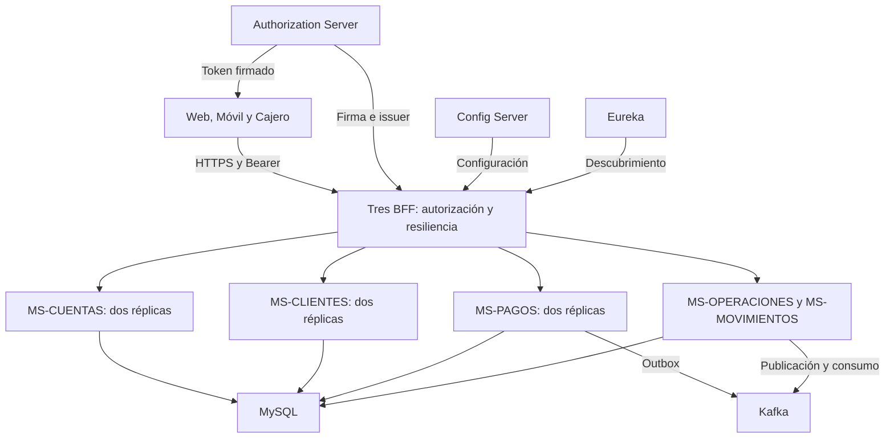
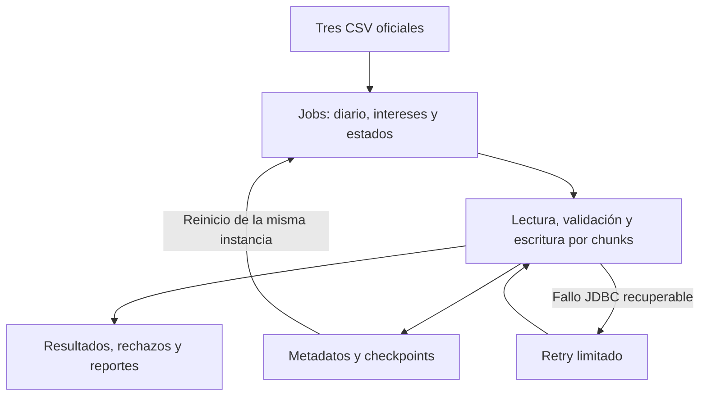
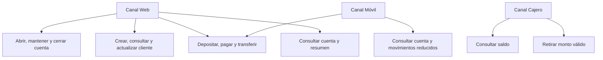
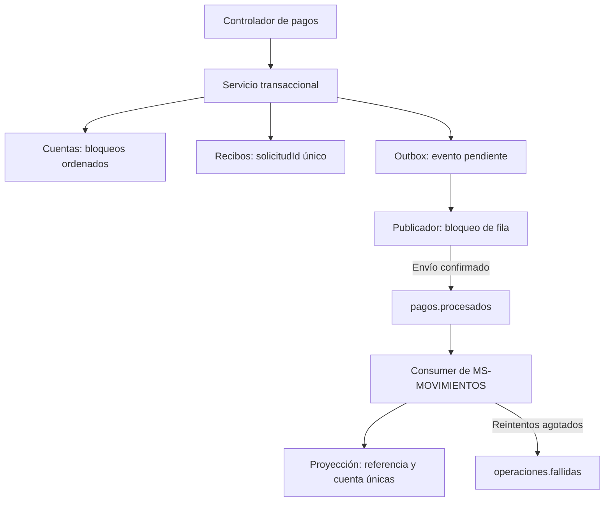

# Banco XYZ — Arquitectura, casos de uso y componentes

## Arquitectura

Cada BFF valida OAuth2, autoriza canal/cuenta y usa llamadas HTTP balanceadas con resiliencia. El balanceador está dentro del cliente del BFF; no hay un servicio Gateway adicional. Config Server y Eureka suministran configuración y descubrimiento.

Batch se ejecutó en PC con MySQL; no integra el arranque Compose ni se ejecutó sobre EC2 durante las pruebas bancarias.

## Casos de uso

| Caso | Regla |
| --- | --- |
| Gestión de cuentas | Scope Web y cuenta autorizada; cierre con saldo cero conserva historial |
| Gestión de cliente | Se resuelve el titular desde la cuenta autorizada; actualización controla versión |
| Pagos y transferencias | Monto válido, cuentas activas y clave estable; cambio de saldos atómico |
| Repetición | Misma clave/cuerpo devuelve recibo; clave con cuerpo distinto produce 409 |
| Móvil | Datos reducidos y scopes propios |
| Retiro cajero | Mínimo/múltiplo de 1000; sin Retry automático del POST legado |

## Componentes de pagos y mensajería

Saldos, recibo y outbox se confirman en una transacción. La publicación puede repetirse si se pierde la confirmación; la proyección deduplica por referencia/cuenta y no modifica nuevamente los saldos. Una transferencia genera salida y entrada. El consumidor legado de retiros registra su recepción en logs; no se le atribuyen filas de la proyección SQL de pagos.

Las consultas fallidas producen fallback 503 y recuperan acceso cuando vuelve el servicio. Los errores de negocio 400/404/409 quedan excluidos de Retry y del conteo del circuito. EC2 demostró fallback y recuperación, sin observar OPEN/HALF_OPEN mediante Actuator. MySQL, Kafka y autorización tienen una instancia en este laboratorio.
